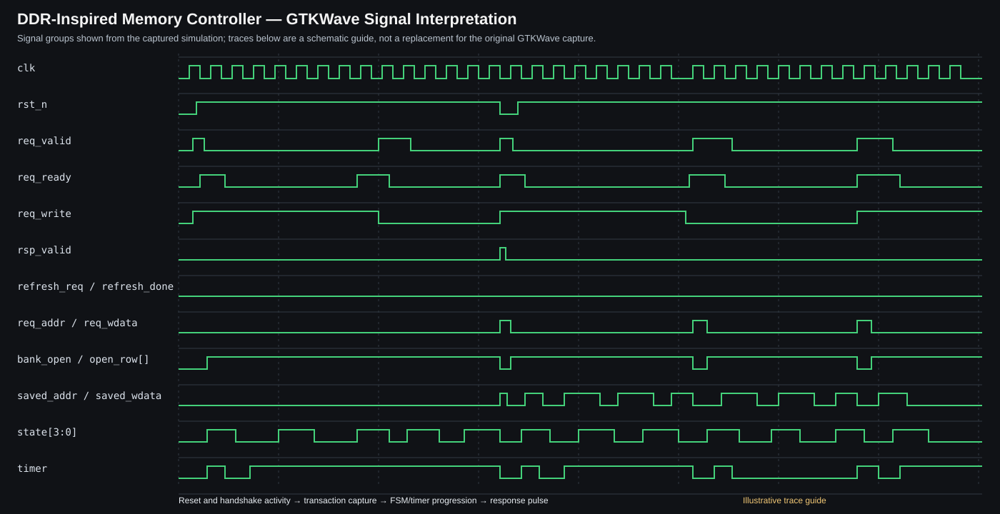

# DDR-Inspired Memory Controller — RTL Design & Functional Verification

[](https://github.com/vamsikrishnatheegela/ddr-controller-verification/actions/workflows/rtl-verification.yml)

An educational **SystemVerilog memory-controller RTL model** with a Python-based **Cocotb verification environment**, compiled and simulated using **Verilator**. The project demonstrates RTL control logic, transaction-level testbench development, scoreboard checking, functional-coverage closure, continuous integration, and waveform-based debugging.

> **Scope and limitations:** This is a simplified, DDR-inspired educational controller. It is **not** a JEDEC-compliant DDR, DDR2, DDR3, DDR4, or DDR5 controller. It does not implement a physical DRAM PHY, DFI, training/calibration, electrical timing, real DDR burst protocol, ECC, or the full refresh and scheduling requirements of commercial DRAM devices.

## Project status

**Current milestone: complete.** The defined local regression passed all 10 tests, functional-coverage goals passed, the GitHub Actions regression passed, and simulation waveform inspection was completed. Further work is optional enhancement, not a blocker for describing this version as completed.

| Milestone | Result |
|---|---|
| SystemVerilog RTL controller | Complete |
| Cocotb regression suite | **10/10 tests passed** in the recorded local run |
| Functional coverage closure | Passed |
| Address-space sweep | **256/256 addresses** exercised |
| Bank/row/column coverage | **4/4 banks, 4/4 rows, 16/16 columns** |
| Read/write × bank coverage | **8/8 bins** |
| GitHub Actions CI | Passed in the recorded run |
| Waveform generation and inspection | Completed using GTKWave |
| Functional-coverage changes | Merged into `main` (PR #1) |

These results apply to the defined tests and coverage goals; they are not a formal proof of correctness, JEDEC compliance, physical performance, or silicon behavior. Check the latest workflow run for current CI status.

## Key features

- Single-request-at-a-time controller FSM.
- Four logical banks and an internal behavioral memory model.
- Row opening, access, precharge-like behavior, and refresh sequencing.
- Simplified programmable/cycle-based timing parameters.
- Read and write transaction handling with request/response handshake signals.
- Active-low asynchronous reset and reset-recovery testing.
- Row-conflict handling and request blocking during refresh.
- Cocotb tests, Python reference-model scoreboard, and a functional-coverage collector.
- Full 256-address write/readback sweep.
- Automated GitHub Actions regression and downloadable verification evidence.

## Architecture

### Address mapping

The 8-bit request address is divided into bank, row, and column fields:

| Address bits | Field | Range |
|---|---|---|
| `[7:6]` | Bank | 0–3 (4 banks) |
| `[5:4]` | Row | 0–3 (4 rows per bank) |
| `[3:0]` | Column | 0–15 (16 columns per row) |

The behavioral memory contains 256 bytes in total. This address mapping is deliberately small so that the complete address space can be swept in simulation.

### Request/response interface

- `req_valid`: requester indicates a transaction is available.
- `req_ready`: controller indicates it can accept a transaction.
- A request is accepted when `req_valid && req_ready` is true.
- `req_write=1`: write request; `req_write=0`: read request.
- `req_addr[7:0]`: 8-bit address.
- `req_wdata[7:0]`: 8-bit write data.
- `rsp_valid`: response-valid indication.
- `rsp_rdata[7:0]`: 8-bit read data.
- `refresh_req` / `refresh_done`: refresh request and completion signals.
- `clk` and active-low asynchronous `rst_n`: clock and reset.

### Controller state machine

The RTL models these states:

1. `ST_IDLE` — wait for a request or refresh activity.
2. `ST_PRECHARGE` — close/precharge a conflicting open row.
3. `ST_ACTIVATE` — open the target row.
4. `ST_RCD_WAIT` — wait the simplified row-to-column delay.
5. `ST_ACCESS` — perform the behavioral read/write access.
6. `ST_RESPONSE` — return transaction response.
7. `ST_REFRESH_PRE` — prepare banks for refresh.
8. `ST_REFRESH_WAIT` — wait the simplified refresh interval.

The RTL includes timing parameters such as `MAX_DELAY`, `TIMER_W`, `T_RCD`, `T_RFC`, and `T_RP`. In this educational model, timing values represent simulation-cycle counts, not real DRAM timing in nanoseconds.

## Verification methodology

The testbench is written in Python using Cocotb. It drives the controller interface, observes responses, checks transaction results, and uses a reference-model scoreboard for deterministic mixed traffic. A functional-coverage collector tracks whether selected behaviors and address dimensions have been exercised.

### Test scenarios

The 10-test regression includes:

1. Write/readback behavior.
2. Access across multiple banks.
3. Refresh closes rows and completes.
4. Row-conflict behavior preserves data at each address.
5. Request is not accepted during refresh.
6. Deterministic mixed traffic checked with a scoreboard.
7. Reset clears controller and behavioral memory state.
8. Full address-space sweep.
9. Consecutive transactions keep data isolated.
10. Functional-coverage closure.

### Functional coverage goals

The coverage collector checks:

- **Address space:** 256/256 addresses.
- **Address dimensions:** 4/4 banks, 4/4 rows, and 16/16 columns.
- **Operations:** read and write.
- **Cross coverage:** 8/8 operation-by-bank bins.
- **Write-data classes:** zero, all-ones, alternating patterns (including `0x55`/`0xAA`), and other values.
- **Refresh:** minimum request and completion event goals.
- **Reset:** reset-event goal.

Coverage closure is based on these explicitly defined bins and event goals. It should not be interpreted as exhaustive functional or formal coverage of all possible RTL behaviors.

## Simulation waveform and signal-level analysis

### Waveform overview

The waveform below is a **signal-interpretation guide based on the GTKWave capture**. It explains the signal groups and transaction sequence. It is not a byte-for-byte copy of the GTKWave screenshot; the original capture is currently not stored as a repository image.



### What the signals show

| Signal | What to look for in the waveform |
|---|---|
| `clk` | Clock edges that sequence the controller's synchronous state transitions. |
| `rst_n` | Active-low reset. When asserted low, the controller is reset; normal transactions should occur after reset is released. |
| `req_valid` / `req_ready` | Request handshake. A request is accepted on a clock edge when both are high. |
| `req_write` | Selects a write (`1`) or read (`0`) request. |
| `req_addr[7:0]` / `req_wdata[7:0]` | Address and write-data values presented by the requester. In the screenshot, address/data buses change between transactions. |
| `rsp_valid` / `rsp_rdata[7:0]` | Response indication and returned read data. Check that the response corresponds to the accepted request. |
| `bank_open[3:0]` / `open_row[]` | Internal bank-open and row tracking. These help inspect row activation and row-conflict handling. |
| `saved_addr`, `saved_bank`, `saved_row`, `saved_wdata`, `saved_write` | Latched transaction context used while the controller processes a request. |
| `state[3:0]` | FSM state encoding. Transitions show the controller progressing through precharge/activate/wait/access/response and refresh states. The numeric values correspond to the RTL enum encodings. |
| `timer[2:0]` and timing parameters | Cycle counter and simplified timing values used by the educational model. These are cycle counts, not real DRAM nanoseconds. |
| `refresh_req` / `refresh_done` | Refresh request and completion. Use them with FSM state and bank/row signals to inspect refresh sequencing. |

### How to interpret a transaction

1. **Request presentation:** the requester drives `req_valid`, `req_write`, `req_addr`, and (for writes) `req_wdata`.
2. **Acceptance:** a transaction is accepted when `req_valid && req_ready` is true on a clock edge.
3. **Transaction capture:** the controller stores the address, bank, row, data, and operation in the `saved_*` registers.
4. **Controller execution:** `state` and `timer` show the FSM and simplified delay progression. Bank/row signals help identify row-opening and conflict behavior.
5. **Response:** for reads, inspect `rsp_valid` and `rsp_rdata` and compare the returned byte with the testbench's expected value.
6. **Reset and refresh:** inspect `rst_n`, `refresh_req`, and `refresh_done` alongside the FSM to understand reset recovery and refresh blocking/completion.

Waveform inspection is a debugging and review aid. Passing the regression and coverage checks provides the test evidence; the waveform alone does not prove correctness, JEDEC compliance, or performance.

### Waveform artifact

The GTKWave screenshot was viewed during local verification, but the original screenshot file has not yet been committed to this repository. The SVG above is an explanatory guide, not the raw simulator trace. To make the exact screenshot appear here, add the original screenshot as `docs/images/gtkwave_capture.png` and replace the image above with that file.

No ModelSim installation is required for this project. The documented flow uses Verilator for simulation and GTKWave for viewing waveform traces.

## Tools and technologies

- **RTL:** SystemVerilog
- **Testbench:** Python, Cocotb 2.1.x
- **Simulator:** Verilator 5.036 or later
- **Waveform viewer:** GTKWave
- **Automation/build:** Make, Git, GitHub Actions
- **Verification concepts:** FSM-based control, request/response handshakes, directed testing, deterministic mixed traffic, reference-model scoreboard, functional coverage, regression logging, waveform debugging

## Run the existing project

This repository's verified flow uses **Verilator + Cocotb**. **ModelSim is not required.** If you have already set up the tools and the tests pass on your machine, you do not need to install anything else just to read this README or inspect the project results.

Run the regression and request waveform output:

```bash
make clean
make SIM=verilator WAVES=1
find . -type f \( -name "*.vcd" -o -name "*.fst" \) -print
```

Open the generated VCD/FST file in GTKWave. The exact file location depends on the local Cocotb/Verilator setup. A normal regression also writes JUnit-style `results.xml`.

To preserve a readable local test log:

```bash
mkdir -p artifacts
set -o pipefail
make SIM=verilator WAVES=1 2>&1 | tee artifacts/regression.log
```

## Continuous integration and evidence

Every push to `main`, pull request, or manual workflow dispatch triggers the GitHub Actions verification workflow. It records the commit SHA and tool versions, runs the regression, and uploads available regression logs, JUnit XML, waveform/build outputs as a downloadable artifact.

- **[RTL Verification workflow and run history](https://github.com/vamsikrishnatheegela/ddr-controller-verification/actions/workflows/rtl-verification.yml)**
- **[Cocotb testbench](tests/test_ddr_controller.py)**
- **[Verification plan](docs/verification_plan.md)**

The workflow artifact is the best place to retrieve evidence associated with a particular CI commit. The README embeds the explanatory waveform guide above; the exact local GTKWave screenshot still needs to be added as a repository image to display the original capture here.

## Applications and relevance

This project demonstrates foundational techniques applicable to:

- RTL design and verification of memory-interface IP.
- SoC peripheral and embedded-system controller blocks.
- Behavioral memory and SRAM/BRAM controller exercises.
- Pre-silicon functional validation and regression automation.
- Debugging FSM-based control logic using waveform traces.
- Verification environments built around scoreboards and functional coverage.

These are skill-transfer and learning applications. The current RTL is not suitable for direct use as a commercial DDR controller.

## Future engineering enhancements

The current milestone is complete. Potential extensions include:

- Add SystemVerilog Assertions (SVA) for handshake, response, reset, and refresh properties.
- Add constrained-random traffic and reproducible seeds.
- Measure request latency, sustained throughput, and refresh overhead.
- Increase FSM transition and corner-case coverage.
- Parameterize address geometry and timing, then test parameter boundaries.
- Add lint and formal-property checks.
- Explore synthesis/timing reports using a documented flow and explicit constraints.
- Develop a more realistic protocol model if the goal is to study JEDEC DDR behavior.

If reporting PPA or performance figures, include the exact tool versions, constraints, target library, measurement method, and reports. No PPA or JEDEC-compliance claim is made for the current project.

## Project layout

```text
.github/workflows/rtl-verification.yml
rtl/ddr_controller.sv
tests/test_ddr_controller.py
Makefile
docs/verification_plan.md
```

## License

MIT — see [LICENSE](LICENSE).
