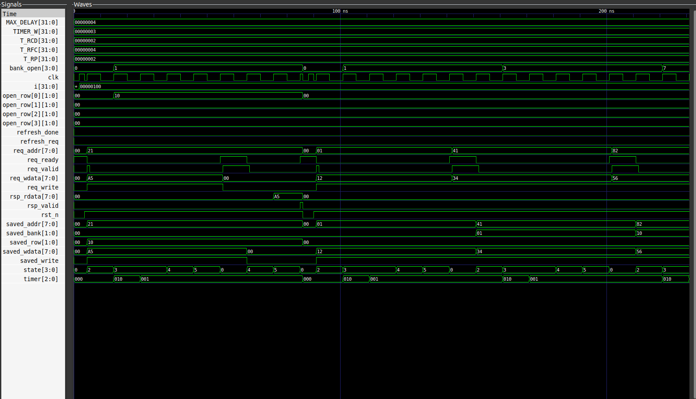

# DDR-Inspired Memory Controller
### SystemVerilog RTL Design • Cocotb Verification • Functional Coverage • Waveform Debugging

[](https://github.com/vamsikrishnatheegela/ddr-controller-verification/actions/workflows/rtl-verification.yml)

An educational memory-controller project built to practice **RTL design and pre-silicon functional verification**. The controller is implemented in SystemVerilog, tested with a Python/Cocotb testbench, simulated with Verilator, and debugged using GTKWave.

> **Important scope note:** This is a simplified DDR-inspired behavioral controller, not a JEDEC-compliant DDR/DDR2/DDR3/DDR4/DDR5 controller. It models selected bank, row, timing, transaction, and refresh concepts for learning and verification practice. It does not implement a physical DRAM PHY, DFI, training/calibration, electrical timing, full DDR command/burst behavior, or commercial DRAM scheduling requirements.

---

## At a glance

| Item | Details |
|---|---|
| Design | Simplified four-bank memory controller |
| RTL language | SystemVerilog |
| Verification | Python + Cocotb |
| Simulator | Verilator |
| Waveform viewer | GTKWave |
| Automation | Make + GitHub Actions |
| Recorded regression | **10 passed, 0 failed, 0 skipped** |
| Address sweep | **256/256 addresses exercised** |
| Address dimensions | **4/4 banks, 4/4 rows, 16/16 columns** |
| Operation × bank coverage | **8/8 bins** |
| Current milestone | **Complete; further work is optional enhancement** |

The results above are from the recorded regression and coverage run. They demonstrate that the defined tests and coverage goals passed; they are not a formal proof of all possible behavior or protocol compliance.

## 1. Project goals

The project was developed to demonstrate an end-to-end RTL verification workflow:

- Implement a controller using a finite-state machine (FSM).
- Model a small banked memory with row tracking.
- Support read/write transactions using request/response handshake signals.
- Model simplified access, precharge-like, and refresh timing.
- Verify behavior with directed tests and deterministic mixed traffic.
- Use a reference-model scoreboard to check expected data.
- Track functional coverage and assert defined coverage goals.
- Run regression automatically in GitHub Actions.
- Inspect transaction timing and internal control signals in GTKWave.

## 2. RTL architecture

### Simplified memory organization

The request address is 8 bits and is split into bank, row, and column fields:

| Address bits | Field | Number of values |
|---|---|---:|
| `req_addr[7:6]` | Bank | 4 |
| `req_addr[5:4]` | Row | 4 per bank |
| `req_addr[3:0]` | Column | 16 per row |

This gives **4 × 4 × 16 = 256 byte-addressable locations** in the behavioral model. The compact address space makes exhaustive address sweeping practical.

### Request and response interface

| Signal | Role |
|---|---|
| `clk` | Controller clock |
| `rst_n` | Active-low asynchronous reset |
| `req_valid` | Requester presents a transaction |
| `req_ready` | Controller can accept a request |
| `req_write` | `1` for write, `0` for read |
| `req_addr[7:0]` | Address of the requested location |
| `req_wdata[7:0]` | Write data |
| `rsp_valid` | Response-valid indication |
| `rsp_rdata[7:0]` | Read response data |
| `refresh_req` | Refresh request |
| `refresh_done` | Refresh completion indication |

A request is accepted on a clock edge when `req_valid` and `req_ready` are both asserted. The controller saves the transaction context so that it can process the request through subsequent FSM states.

### Controller FSM

The RTL contains the following states:

1. `ST_IDLE` — wait for a request or refresh activity.
2. `ST_PRECHARGE` — close/precharge a conflicting open row.
3. `ST_ACTIVATE` — open the target row.
4. `ST_RCD_WAIT` — wait the model's simplified row-to-column delay.
5. `ST_ACCESS` — perform the behavioral read or write.
6. `ST_RESPONSE` — return the response.
7. `ST_REFRESH_PRE` — prepare banks for refresh.
8. `ST_REFRESH_WAIT` — wait for the model's refresh interval.

Timing-related parameters include `MAX_DELAY`, `TIMER_W`, `T_RCD`, `T_RFC`, and `T_RP`. They represent simplified simulation-cycle timing in this model, **not real DRAM timing specifications in nanoseconds**.

## 3. Actual simulation waveform

The following is the GTKWave screenshot captured from the project's simulation.



### How to read this waveform

The trace shows the clock, external transaction interface, saved transaction fields, bank/row tracking, FSM state, timer, and timing parameters in one view. Together, these signals help correlate what the requester drives with how the controller processes a transaction.

| Signal or group | What it means | What to inspect |
|---|---|---|
| `clk` | Clock | State and registered signals progress relative to clock edges. |
| `rst_n` | Active-low reset | Check the reset assertion and release before normal transaction activity. |
| `req_valid`, `req_ready` | Request handshake | A request is accepted when both are high at a sampling clock edge. |
| `req_write` | Operation selector | Distinguishes write transactions from read transactions. |
| `req_addr[7:0]` | Requested address | Observe address changes between transactions. |
| `req_wdata[7:0]` | Write payload | Check the data value presented for a write. |
| `rsp_valid`, `rsp_rdata[7:0]` | Response and read data | Observe response activity and compare returned data with the testbench's expected value. |
| `saved_addr`, `saved_bank`, `saved_row`, `saved_wdata`, `saved_write` | Captured request context | Confirm that the accepted transaction's fields are retained while the FSM works on it. |
| `bank_open[3:0]`, `open_row[]` | Internal bank and row tracking | Inspect which banks/rows are marked open and how the model handles row changes. |
| `state[3:0]` | Encoded FSM state | Follow controller progression through its access and response sequence. Numeric labels are state encodings, not time values. |
| `timer[2:0]` | Internal timing counter | Observe the counter used for simplified cycle delays. |
| `MAX_DELAY`, `T_RCD`, `T_RFC`, `T_RP`, `TIMER_W` | Timing/configuration values | These are model parameters/constants visible in the trace. |
| `refresh_req`, `refresh_done` | Refresh interface | Correlate refresh request/completion with FSM and bank/row signals when refresh is exercised. |

### Transaction sequence represented by the signals

1. **Present a request:** the requester drives `req_valid`, `req_write`, `req_addr`, and (for a write) `req_wdata`.
2. **Accept the request:** the handshake occurs when `req_valid && req_ready` is true at a clock edge.
3. **Capture transaction details:** `saved_addr`, `saved_bank`, `saved_row`, `saved_wdata`, and `saved_write` show the saved request context.
4. **Execute the operation:** `state`, `timer`, `bank_open`, and `open_row[]` help show the controller's internal progression and row tracking.
5. **Return a response:** inspect `rsp_valid` and, for reads, `rsp_rdata`; the testbench checks behavior against expected results.
6. **Check reset and refresh behavior:** use `rst_n`, `refresh_req`, and `refresh_done` with the FSM to debug these control paths.

**What the waveform establishes:** the simulation exposes the interface and internal state needed for signal-level debugging. Correctness claims come from the regression checks and coverage goals together with RTL review—not from the screenshot alone. The waveform is not evidence of JEDEC compliance, physical timing closure, or silicon performance.

## 4. Verification strategy and results

The testbench uses Cocotb to drive inputs, wait for controller behavior, inspect outputs, and compare results. A reference-model scoreboard checks deterministic mixed traffic. A functional-coverage collector records whether selected address dimensions, operations, data classes, refresh events, and reset events have been exercised.

### Test scenarios

The recorded regression contains 10 tests:

1. Write/readback behavior.
2. Access across multiple banks.
3. Refresh closes rows and completes.
4. Row-conflict handling preserves data at each address.
5. Requests are not accepted during refresh.
6. Deterministic mixed traffic checked with a scoreboard.
7. Reset clears controller and behavioral memory state.
8. Full address-space sweep.
9. Consecutive transactions keep data isolated.
10. Functional-coverage closure.

### Functional coverage

| Coverage item | Recorded result |
|---|---:|
| Address values | **256/256** |
| Banks | **4/4** |
| Rows | **4/4** |
| Columns | **16/16** |
| Read and write operations | Both exercised |
| Operation × bank cross | **8/8 bins** |
| Write-data classes | Zero, all-ones, alternating (`0x55`/`0xAA`), other |
| Refresh request/completion | Defined minimum event goals passed |
| Reset | Defined event goal passed |

Coverage closure means the **specified bins and event goals** were met. It does not imply every possible FSM transition, input combination, timing corner, or formal property has been proven.

### Continuous integration

The GitHub Actions workflow builds/uses the specified Verilator version, installs Cocotb, runs the regression, records the tool/version and regression log, and uploads available verification evidence.

- [RTL Verification workflow and run history](https://github.com/vamsikrishnatheegela/ddr-controller-verification/actions/workflows/rtl-verification.yml)
- [Cocotb testbench](tests/test_ddr_controller.py)
- [Verification plan](docs/verification_plan.md)

The functional-coverage milestone was merged into `main` in PR #1. Documentation changes are tracked separately in PR #2.

## 5. Technology stack and skills demonstrated

**Tools:** SystemVerilog, Python, Cocotb, Verilator, GTKWave, Make, Git, GitHub, GitHub Actions.

**RTL design:** FSM design, handshake-based interfaces, behavioral memory modeling, address decoding, bank/row tracking, reset sequencing, simplified timing control, refresh sequencing.

**Verification:** directed testing, deterministic mixed traffic, reference-model scoreboard, read/write data checking, address-space sweep, functional coverage, regression automation, waveform-based debugging, log/evidence capture.

## 6. Applications and industry relevance

The techniques demonstrated are transferable to:

- RTL design and verification of memory-interface IP.
- SoC control blocks and embedded-system peripherals.
- Behavioral SRAM/BRAM controller exercises.
- Pre-silicon functional validation and regression automation.
- Debugging FSM-based control logic through waveform traces.
- Verification environments using scoreboards and functional coverage.

These are **potential application areas for the demonstrated skills**. This educational controller itself is not intended for direct use as a commercial DDR controller.

## 7. Project completion and possible next steps

### Current milestone: complete

The current version has a recorded **10/10 passing test regression**, passing defined functional-coverage goals, a successful recorded CI run, and a GTKWave capture. It is ready to be presented as an educational RTL design and verification project.

### Optional advancements

These are future enhancements, not missing requirements for the current milestone:

- Add SystemVerilog Assertions (SVA) for handshake, reset, response, and refresh properties.
- Add constrained-random traffic with reproducible random seeds.
- Measure request latency, throughput, and refresh overhead.
- Expand FSM transition and corner-case coverage.
- Parameterize memory geometry and timing, then test boundary configurations.
- Add lint and formal-property checks.
- Explore synthesis/timing reports with documented constraints and a target library.
- Build a more realistic DDR protocol model if JEDEC behavior becomes the project goal.

No synthesis PPA, physical implementation, formal proof, or JEDEC-compliance result is claimed for the current version.

## 8. Repository layout

```text
.github/workflows/rtl-verification.yml   # CI regression workflow
rtl/ddr_controller.sv                    # SystemVerilog controller
tests/test_ddr_controller.py              # Cocotb tests and coverage
docs/verification_plan.md                 # Verification plan
docs/images/gtkwave_capture.png            # Actual GTKWave screenshot
Makefile                                  # Simulation entry point
README.md                                 # Project documentation
```

## License

MIT — see [LICENSE](LICENSE).
